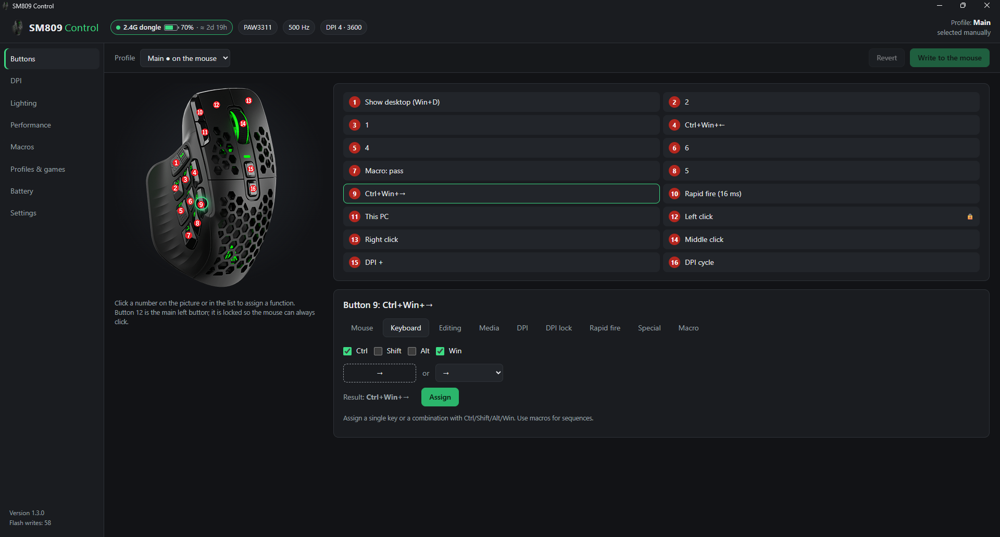
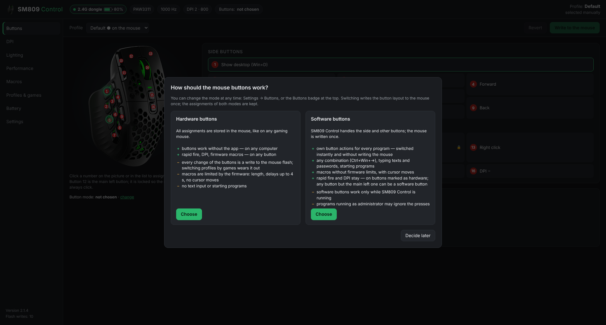
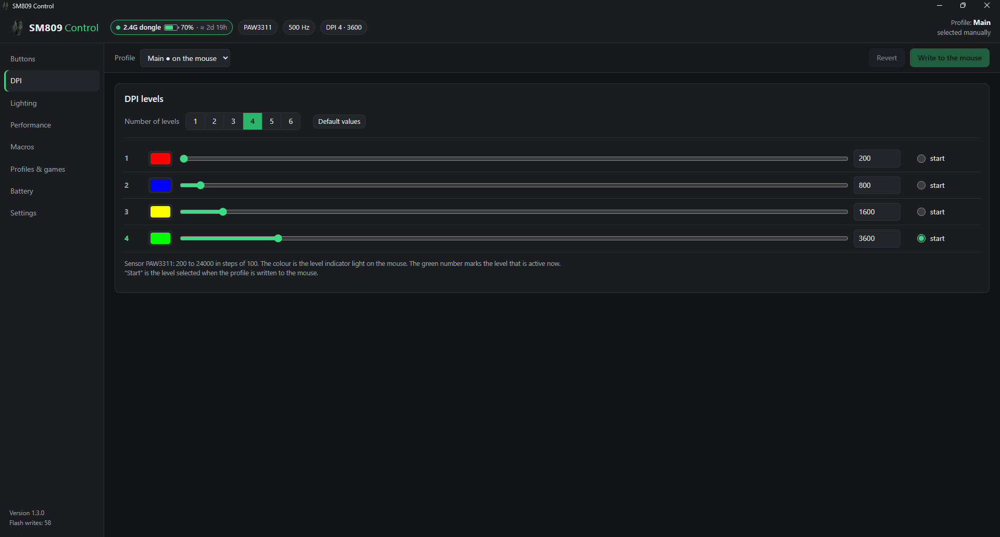
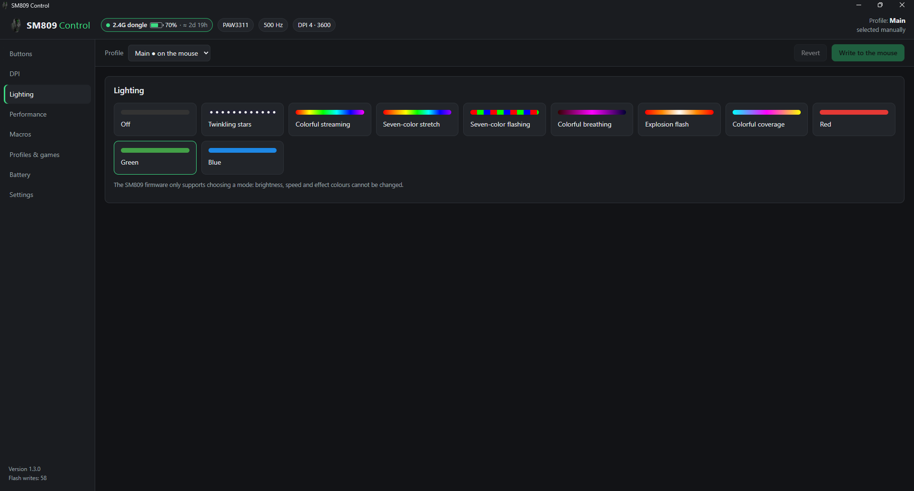
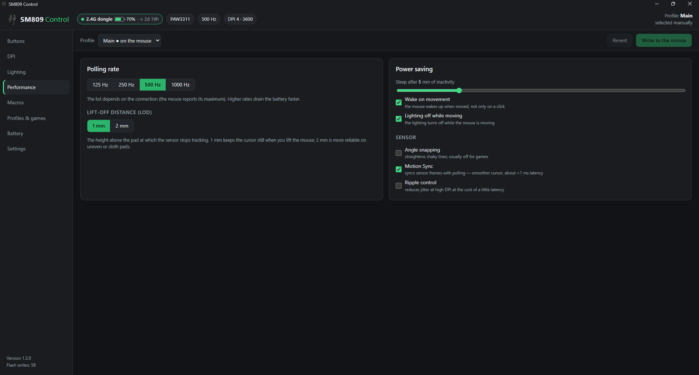
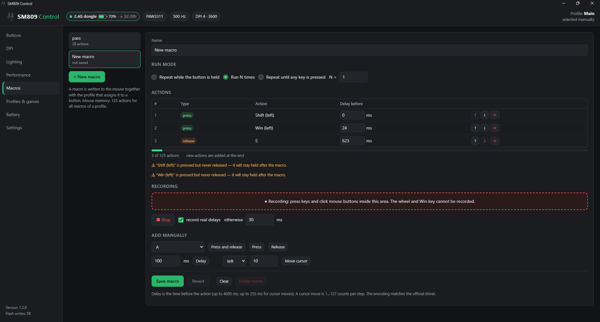
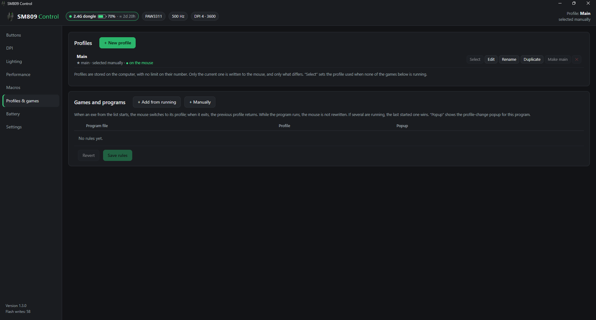
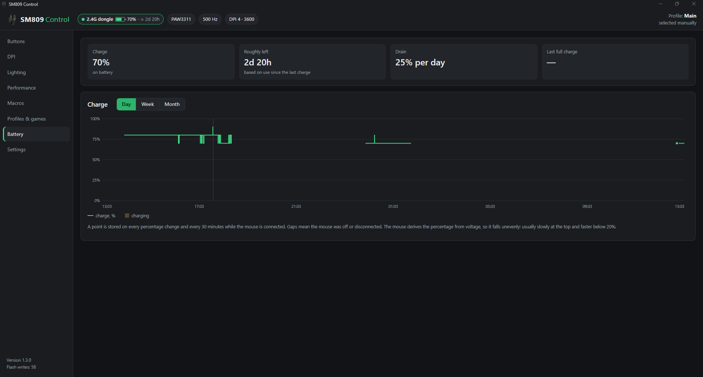
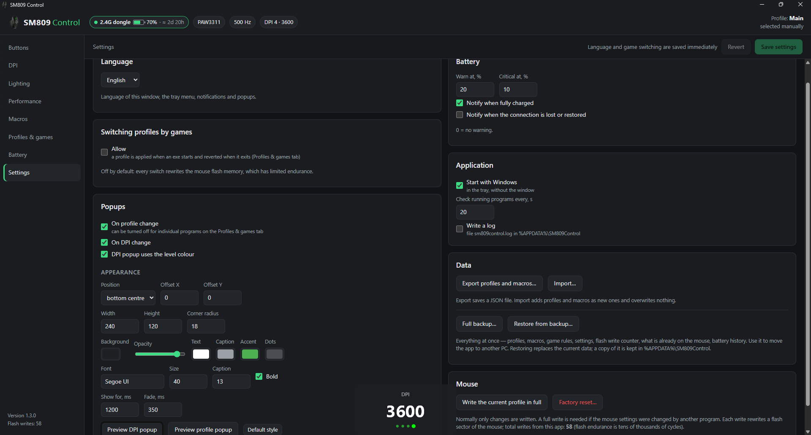

# SM809 Control

An unofficial, open-source configuration app for the **SM809 / SM809 Pro** gaming mouse (Beken BK3633, VID `04F3`). It replaces the vendor's Windows software and does more: software buttons that follow the program in front, typing passwords and starting programs from a mouse button, unlimited profiles, an editable DPI table, a full macro editor, battery history and forecast.

**[Русская версия ниже ↓](#sm809-control-по-русски)**



> ⚠️ Not affiliated with the mouse manufacturer. The protocol was reverse-engineered and every command is checked byte-for-byte against the vendor's own web driver, but you use it at your own risk.

## Features

- **Two button modes.** The app asks on first start; you can switch at any time in Settings → Buttons or with the **Buttons** badge at the top. Assignments of both modes are kept.

  

  - *Hardware*: everything is stored in the mouse and works without the app on any PC.
  - *Software*: SM809 Control handles the buttons. The mouse is written **once**: each button sends a key no keyboard has (F13–F24 and the Japanese-keyboard keys International 1, 4, 5). The app catches it and performs the action of the current profile. Changing actions or switching programs **never writes the mouse**.
- **Software button actions:**
  - any key or combination (Ctrl+Win+→…), with auto-repeat while held;
  - any mouse button;
  - **macros without firmware limits**: any length and delays, cursor moves; while held / N times / until pressed again;
  - **type a text or a password**, either as characters or as real key presses in a chosen keyboard layout, then press Enter, Tab or another key. Passwords are encrypted with Windows DPAPI and never shown again;
  - **start a program** (with arguments);
  - nothing.
- **Mixed buttons.** In software mode any button except the main left one can be marked *hardware button* to keep rapid fire, DPI or a firmware macro on it. The list follows the button layout of the mouse; a green number is a software button, a red number is a hardware one. Pressing a software button lights it up in the window. Every button has **Reset to default**.
- **Buttons per program.** A rule "program → profile" switches the software buttons the instant that program's window comes to the front.
- **Hardware buttons.** Any function on the 15 remappable buttons: mouse buttons, key or combination, media keys, editing shortcuts, DPI +/−/cycle, DPI lock (sniper), rapid fire with interval and count, disable, lighting toggle, firmware macro. The main left button is locked so the mouse can never lose its click.
- **DPI.** 1 to 6 levels, any value per level (limits and step follow the sensor, e.g. PAW3311: 200–24000 in steps of 100), a colour per level, start level.
- **Lighting.** All 11 modes supported by the firmware.
- **Performance.** Polling rate (the list follows the connection), lift-off distance (LOD 1/2 mm, missing in the vendor Windows app), sleep timer, wake on movement, lighting off while moving, angle snapping, Motion Sync, ripple control.
- **Macros.** Recorder (keys and mouse buttons, real or fixed delays) and manual editor (press / release / delay, type a whole text, reorder). Firmware macros are encoded exactly like the vendor driver does, with a memory meter; software-mode macros have no such limits.
- **Profiles.** Unlimited, stored on the PC. Only the current one is written to the mouse, and **only the settings that differ**, to spare the flash memory.
- **Per-game profiles** (opt-in). A profile is written to the mouse when an `.exe` starts and reverted when it exits. Off by default; turned on only after a warning about flash wear. Software buttons don't need it.
- **On-screen popups** for DPI, profile and button-set changes with a customisable look.
- **Connection and battery.** Cable / 2.4 GHz dongle / Bluetooth 1 / Bluetooth 2, battery and charging, also over Bluetooth. Battery history chart, drain per day, time left or time to full, low-battery notifications. The bogus reading the mouse sends for the first seconds after connecting (0 %, then too high) is ignored, and the back-and-forth at a 10 % step (80 ↔ 90 every few seconds) is smoothed out: a drop counts after 3 minutes, a step back after 30.
- **Connection diagnostics.** Settings → Mouse → *Connection diagnostics…* shows what Windows exposes and what the mouse answers; save it to a file for a bug report.
- **Read settings from the mouse** (cable). Reads the mouse memory (read-only), compares it with the current profile and can turn it into a profile.
- **Experimental:** key debounce threshold, a hidden firmware setting for switches that start to double-click.
- **The window remembers its size, position and maximized state** between openings (close it to the tray and open it again).
- **Tray icon** with battery level and quick profile switching, autostart, **backup** of profiles and macros or of all app data.
- **English and Russian** UI.

| | |
|---|---|
|  |  |
|  |  |
|  |  |



## Why not the vendor software?

| | SM809 Control | Vendor web driver | Vendor Windows app |
|---|---|---|---|
| Writes to the mouse | **only the settings that changed**; in software mode, button changes write nothing | buttons **and all macros** every time the page opens, on any change, even when you press the DPI button | |
| Buttons per program | **instant, no flash writes** (software mode) | no | no |
| Type text / passwords, start programs | **yes** | no | no |
| Reads what is stored in the mouse | **yes** (cable) | no | no |
| Profiles | **unlimited** | several, manual | 3 |
| DPI values | any per level | any per level | fixed list |
| Lift-off distance (LOD) | yes | yes | no |
| Macros | recorder, editor, text; no limits in software mode | recorder, editor | recorder, editor |
| Key debounce (hidden setting) | yes (experimental) | no | no |
| Battery | history, drain, time left, notifications, also over Bluetooth | | current % |
| Runs | tray app, no browser, no install | browser tab (WebHID) | installer |

**Why it matters.** The mouse rewrites a 4 KB flash sector for every settings command it accepts, and flash has a limited number of rewrites. The web driver resends all buttons and macros on almost any action, so a simple session costs dozens of rewrites. SM809 Control tracks what is already in the mouse and sends only real differences. In software mode the button layout is written once and per-program buttons cost nothing at all.

After using the vendor software, use **Settings → Mouse → Read settings from the mouse** (cable) or **Write the current profile in full**: the vendor tools overwrite the mouse without telling anyone.

## Download and run

Get `SM809Control_vX.Y.Z.exe` from [Releases](../../releases). It is a single file; no installation.

- Windows 10/11. The UI uses the WebView2 runtime that ships with Windows; without it the UI opens in the default browser.
- The app lives in the tray. Left click opens the window, right click opens the menu.
- The window is a separate short-lived process. When you close it, only a small background part (≈10–15 MB) keeps running for the tray, popups and software buttons.
- Do not run the vendor software or web driver at the same time.

**First run.**
1. Choose the button mode (you can change it later).
2. The app has to know what is in the mouse. With the cable connected, press **Read from the mouse** in the yellow bar: nothing is written, and from then on only differences are. Without the cable, check the tabs and press **Write … to the mouse** once.

**Notes on software mode.**
- Software buttons do nothing while SM809 Control is not running. Turn on *Settings → Buttons → Restore the hardware layout when the app exits* if you want the mouse to work normally after closing the app (this costs one write per exit and start).
- With a Japanese input method active, the International keys of buttons 14–16 may be seen by the IME before the app; mark those buttons as hardware if that bothers you.
- Programs running as administrator (some games and launchers) are a special case — see [Administrator rights](#administrator-rights).
- Switching the mode or marking a button hardware/software writes the key layout to the mouse once.

Data is stored in `%APPDATA%\SM809Control` (`data.json`: profiles, macros, rules, settings; `device.json`: what is on the mouse; `battery.json`: battery history).

## Administrator rights

SM809 Control does not need administrator rights. Mouse settings, DPI, lighting, battery and **hardware** buttons work the same either way — they live in the mouse. Rights matter only for **software buttons** used in programs that themselves run as administrator (some games, anti-cheat launchers, Task Manager, installers, an elevated console).

**When SM809 Control runs without rights and the program in front runs as administrator** (Windows UIPI — User Interface Privilege Isolation):
- Windows does not pass that program's keyboard input to the app's keyboard hook (Microsoft documents the same for the PowerToys keyboard remapper). The software button's carrier key (F13–F24, International 1/4/5) is therefore **not intercepted**: it reaches the program unchanged, and the button's action is not performed. Most programs ignore these keys, but a game can let you bind them.
- So no software action runs in that window — keys, text, macros and "Start" alike. Input sent by a normal-level app would be blocked by Windows there anyway.
- Hardware buttons (including keys written to the mouse) work normally: the mouse itself is a keyboard. Profiles by the program in front still switch correctly.
- Switch to another (normal) window and everything works again — the limit applies only while an elevated window is in front.

**When SM809 Control runs as administrator**, software buttons work in every window. Two side effects:
- Programs started by a "Start" action (and the vendor links in the app) inherit administrator rights. A URL usually opens in a browser that is already running and keeps its normal rights.
- The normal Windows autostart (the `Run` registry key) **silently skips** programs that need elevation — the entry shows as "Enabled" in Task Manager → Startup apps, but nothing starts. See below.

**How to run it as administrator:** exe properties → *Compatibility* → *Run this program as an administrator* (also check *Change settings for all users*), or the same option in a shortcut's *Advanced* settings. Every manual start then shows a UAC prompt; autostart does not.

**Autostart as administrator.** When the app runs as administrator, *Settings → Application → Start with Windows* (and the tray menu item) creates a **Task Scheduler** task `SM809Control` with `schtasks` instead of the `Run` entry; the settings show a note about it. The task:
- starts at your logon, *Run with highest privileges*, 5 s delay, without a UAC prompt;
- has **no execution time limit** (the scheduler's default would stop the app after 72 hours), runs on battery, normal process priority (the default is below normal);
- is rewritten at every elevated start (the exe may have moved); an old `Run` entry is moved over to the task.

Unticking the option while running as administrator removes the task. A normal-level app cannot change the task — the checkbox is greyed out with a hint; start the app as administrator once to turn autostart off or back to the normal `Run` entry. Manual removal: `schtasks /Delete /TN SM809Control /F` in an administrator console, or Task Scheduler → Task Scheduler Library → *SM809Control* → Delete.

## Supported devices

SM809 / SM809 Pro family with Elan VID `0x04F3`: PID `0x026E` (wired), `0x026F` (2.4 GHz dongle), `0x026D` (Bluetooth LE). The sensor type is read from the mouse (PAW3311, PAW3395, PAW3950 and others from the vendor table).

## Building

Go 1.24, from any OS:

```sh
GOOS=windows GOARCH=amd64 go build -trimpath -ldflags "-H windowsgui -s -w" -o SM809Control.exe .
```

- Dependencies (go-webview2, go-winloader, trimmed golang.org/x/sys) are vendored in `third_party/` via `replace` in `go.mod`; no network needed.
- Icon, manifest and version info are in `res/`, compiled into `rsrc_windows_amd64.syso` with `llvm-windres --target=pe-x86-64 -i res/app.rc -o rsrc_windows_amd64.syso`.
- The UI is plain HTML/JS/CSS in `web/`, embedded into the exe.

Tests:

```sh
go test .               # protocol encoders vs. packets captured from the vendor web driver, carrier layout
sh linuxtest/run.sh     # engine/API logic with HID stubbed out (Linux/macOS)
```

## Releasing

1. Set the version in `main.go` (`const appVersion = "X.Y.Z"`) and in `res/app.rc`, then regenerate the `.syso`.
2. Push to `main`.
3. On GitHub, create a release with the tag `vX.Y.Z` (the same version).

The `build` workflow runs the tests, builds `SM809Control_vX.Y.Z.exe` and attaches it to the release. It fails if the tag does not match `appVersion`. Every push and pull request also builds the exe as a workflow artifact.

## Project layout

| Path | What |
|---|---|
| `protocol.go`, `commands.go` | HID command encoders and status parsing |
| `hid.go` | HID enumeration, status reader (input report 4, feature report 5 polling for Bluetooth), command channel (feature report 6 with ack/retry) |
| `engine.go` | Device state, diff-only apply queue, per-game profile stack, notifications |
| `softbind.go`, `softkeys.go` | Button modes: carrier layout, software actions, validation, migration |
| `soft_windows.go`, `soft_actions_windows.go` | Keyboard hook, SendInput, foreground window, text input, macros, starting programs, DPAPI |
| `store.go` | Data model and persistence |
| `battery.go` | Battery history and forecast |
| `api.go` | Local HTTP API (127.0.0.1, random port, token) + SSE for the UI |
| `main.go`, `osd.go`, `icon.go` | Tray, on-screen popups, battery tray icon (Win32) |
| `uihost.go`, `winstate.go` | WebView2 window process; window size/position/maximized state (`window.json`) |
| `web/` | UI |
| `cmd/keyprobe/` | Small tool that logs the keys the mouse sends (used to verify carrier keys) |
| `testdata/` | Key probe logs and connection diagnostics from real hardware |
| `docs/PROTOCOL.md` | Reverse-engineered HID protocol |
| `docs/SOFT_BINDINGS.md` | Design and test notes for software buttons |

## Protocol

See [docs/PROTOCOL.md](docs/PROTOCOL.md): status report, all commands, button codes, macro format and firmware notes.

---

# SM809 Control по-русски

Неофициальная программа с открытым кодом для настройки мыши **SM809 / SM809 Pro**. Заменяет фирменную программу и умеет больше: программные кнопки, которые меняются вслед за активной программой, ввод паролей и запуск программ с кнопки мыши, неограниченное число профилей, любые значения DPI, полноценный редактор макросов, история и прогноз заряда.

> ⚠️ Программа не связана с производителем мыши. Протокол восстановлен самостоятельно, каждая команда сверена байт-в-байт с официальным веб-драйвером, но используете вы её на свой риск.

## Возможности

- **Два режима кнопок.** Программа спрашивает при первом запуске; режим меняется в любой момент в «Настройки → Кнопки» или значком «Кнопки» вверху. Назначения обоих режимов сохраняются.
  - *Аппаратный*: всё хранится в мыши и работает без программы на любом компьютере.
  - *Программный*: кнопки обрабатывает SM809 Control. Мышь записывается **один раз**: каждая кнопка шлёт клавишу, которой нет на обычной клавиатуре (F13–F24 и клавиши японской клавиатуры International 1, 4, 5). Программа перехватывает её и выполняет действие текущего профиля. Смена действий и переключение программ **не пишут в мышь**.
- **Действия программных кнопок:**
  - любая клавиша или сочетание (Ctrl+Win+→…), с повтором при удержании;
  - любая кнопка мыши;
  - **макросы без ограничений прошивки**: любой длины и с любыми задержками, с движением курсора; пока нажата / N раз / до повторного нажатия;
  - **ввод текста или пароля** символами или настоящими нажатиями клавиш в выбранной раскладке, затем Enter, Tab или другая клавиша. Пароли шифруются средствами Windows (DPAPI) и больше не показываются;
  - **запуск программы** (с аргументами);
  - ничего.
- **Смешанные кнопки.** В программном режиме любую кнопку, кроме основной левой, можно отметить «аппаратной», чтобы оставить на ней огонь, DPI или макрос прошивки. Список повторяет расположение кнопок на мыши: зелёный номер — программная кнопка, красный — аппаратная. Нажатая программная кнопка подсвечивается в окне. У каждой кнопки есть «По умолчанию».
- **Кнопки по программам.** Правило «программа → профиль» переключает программные кнопки в момент, когда окно программы становится активным.
- **Аппаратные кнопки:** любая функция на 15 переназначаемых кнопок — кнопки мыши, клавиша или сочетание, мультимедиа, правка, DPI, фиксация DPI, «огонь», отключение, подсветка, макрос прошивки. Основная левая кнопка заблокирована.
- **DPI:** 1–6 уровней с любыми значениями, цвет каждого уровня, стартовый уровень.
- **Подсветка:** все 11 режимов прошивки.
- **Производительность:** частота опроса, высота отрыва LOD (её нет в фирменной программе), сон, пробуждение движением, angle snapping, Motion Sync, Ripple.
- **Макросы:** запись и ручной редактор, ввод целого текста. Макросы прошивки кодируются точно как в официальном драйвере, с индикатором памяти; у макросов программного режима этих ограничений нет.
- **Профили:** без ограничения количества, хранятся на компьютере. В мышь пишется только то, что отличается.
- **Переключение по играм** (по желанию): профиль записывается в мышь при запуске exe и возвращается при выходе. По умолчанию выключено и включается только после предупреждения об износе флеш-памяти. Программным кнопкам оно не нужно.
- **Всплывающие окна** DPI, профиля и набора кнопок с настройкой внешнего вида.
- **Подключение и батарея:** провод, донгл, BT1, BT2, заряд — в том числе по Bluetooth. График заряда, расход в сутки, прогноз остатка и времени до полной зарядки, уведомления. Ложный заряд в первые секунды после подключения (0 %, затем завышенный) не учитывается, а «пила» на границе шага 10 % (80 ↔ 90 каждые несколько секунд) сглаживается: снижение засчитывается через 3 минуты, обратный шаг — через 30.
- **Диагностика подключения:** «Настройки → Мышь → Диагностика подключения…» показывает, что видит Windows и что отвечает мышь; можно сохранить в файл для отчёта об ошибке.
- **Чтение настроек из мыши** (по кабелю): только чтение, сравнение с профилем, можно сделать из этого профиль.
- **Экспериментальное:** антидребезг кнопок — скрытая настройка прошивки на случай даблкликов.
- **Окно запоминает размер, положение и «развёрнуто во весь экран»** между открытиями (закрыли в трей — открылось таким же).
- **Трей, автозапуск, резервная копия** профилей и макросов или всех данных.
- **Русский и английский** интерфейс.

## Чем лучше фирменных программ

- **Бережёт память мыши.** Мышь перезаписывает сектор флеш-памяти на каждую принятую команду, а ресурс перезаписи ограничен. Веб-драйвер заново пишет все кнопки и макросы почти на любое действие. SM809 Control помнит, что уже записано, и отправляет только реальные отличия. В программном режиме раскладка пишется один раз, а кнопки по программам не стоят ничего.
- **Кнопки по программам, ввод паролей, запуск программ** — в фирменных программах этого нет.
- **Читает настройки из самой мыши** (по кабелю).
- **Профилей без ограничений** (в фирменной программе — 3), **любые значения DPI** и **LOD**.
- **Антидребезг кнопок, история и прогноз заряда** (и по Bluetooth), настраиваемые всплывающие окна, счётчик записей во флеш.
- Работает в трее, без браузера и без установки.

После работы в фирменной программе или веб-драйвере прочитайте настройки из мыши по кабелю или запишите профиль целиком: они перезаписывают мышь, никого не предупреждая.

## Запуск

Скачайте `SM809Control_vX.Y.Z.exe` в [Releases](../../releases). Установка не нужна, программа работает в трее. Не запускайте одновременно с фирменной программой или веб-драйвером.

**Первый запуск.**
1. Выберите режим кнопок (его можно поменять потом).
2. Программе нужно знать, что записано в мыши. Подключите кабель и нажмите «Прочитать из мыши» в жёлтой полосе: ничего не записывается, дальше пишутся только отличия. Без кабеля один раз запишите профиль целиком.

**Про программный режим.**
- Без запущенной программы программные кнопки молчат. Включите «Настройки → Кнопки → При выходе из программы возвращать аппаратную раскладку», если мышь должна работать как обычно после закрытия программы (одна запись при каждом выходе и запуске).
- При включённом японском методе ввода клавиши International на кнопках 14–16 может перехватывать IME раньше программы; если мешает, отметьте эти кнопки аппаратными.
- Программы, запущенные от администратора (некоторые игры и лаунчеры), — особый случай, см. [Права администратора](#права-администратора).
- Смена режима или типа кнопки один раз записывает раскладку в мышь.

Данные хранятся в `%APPDATA%\SM809Control`.

## Права администратора

SM809 Control не нужны права администратора. Настройки мыши, DPI, подсветка, заряд и **аппаратные** кнопки работают одинаково — всё это хранится в мыши. Права важны только для **программных кнопок** в программах, которые сами запущены от администратора (некоторые игры, лаунчеры с античитом, диспетчер задач, установщики, консоль администратора).

**SM809 Control запущен без прав, а программа на переднем плане — от администратора** (механизм Windows UIPI — изоляция привилегий интерфейса):
- Windows не передаёт клавиатурный ввод этой программы в перехватчик клавиатуры SM809 Control (Microsoft описывает то же для переназначения клавиш в PowerToys). Клавиша-носитель программной кнопки (F13–F24, International 1/4/5) **не перехватывается**: она доходит до программы как есть, а действие кнопки не выполняется. Большинство программ такие клавиши игнорирует, но в игре их можно назначить.
- Поэтому в таком окне не выполняется ни одно программное действие — ни клавиши, ни текст, ни макросы, ни «Запустить». Ввод от программы без прав Windows туда и так бы не пропустил.
- Аппаратные кнопки (в том числе клавиши, записанные в мышь) работают как обычно: мышь сама является клавиатурой. Профили по программе на переднем плане переключаются правильно.
- Стоит переключиться в обычное окно — всё снова работает: ограничение действует, только пока впереди окно администратора.

**SM809 Control запущен от администратора** — программные кнопки работают во всех окнах. Два побочных эффекта:
- Программы, запущенные действием «Запустить» (и ссылки из окна программы), получают права администратора. Ссылка обычно открывается в уже запущенном браузере, и его права не меняются.
- Обычный автозапуск Windows (раздел реестра `Run`) **молча пропускает** программы, которым нужны права: в диспетчере задач → «Автозагрузка» запись видна и «Включена», но ничего не стартует. См. ниже.

**Как запускать от администратора:** свойства exe → «Совместимость» → «Запускать эту программу от имени администратора» (и «Изменить параметры для всех пользователей»), либо то же в свойствах ярлыка → «Дополнительно». При ручном запуске будет запрос UAC, при автозапуске — нет.

**Автозапуск от администратора.** Если программа запущена от администратора, «Настройки → Программа → Запускать вместе с Windows» (и пункт в меню трея) создаёт командой `schtasks` задачу **Планировщика заданий** `SM809Control` вместо записи `Run`; в настройках об этом есть строка. Задача:
- запускается при входе в систему, «с наивысшими правами», через 5 с, без запроса UAC;
- **без ограничения времени работы** (по умолчанию Планировщик остановил бы программу через 72 часа), работает от батареи, с обычным приоритетом процесса (по умолчанию — ниже обычного);
- перезаписывается при каждом запуске от администратора (exe мог переехать); старая запись `Run` переносится в задачу.

Снятая галочка при запуске от администратора удаляет задачу. Программа без прав задачу изменить не может — галочка неактивна, рядом подсказка; чтобы выключить автозапуск или вернуться к обычной записи `Run`, один раз запустите программу от администратора. Вручную: `schtasks /Delete /TN SM809Control /F` в консоли администратора или Планировщик заданий → Библиотека → *SM809Control* → Удалить.

**Сборка и выпуск:** см. разделы [Building](#building) и [Releasing](#releasing) выше. Чтобы выпустить версию, создайте на GitHub релиз с тегом `vX.Y.Z`, совпадающим с `appVersion`: сборка сама приложит `SM809Control_vX.Y.Z.exe`.
